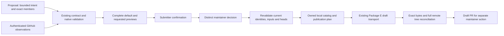

# Phase 5 design proposal: review and publication integration

2026-10-26. **M1 planning proposal; no implementation or policy acceptance is
implied.** Baseline `ef3b2713cf5dcab9b92395321c6be3fdf1efdbce` includes merged
Phase 4 M7. Existing code and limitations are traced in the
[audit](PHASE5_EXISTING_BEHAVIOUR_AUDIT.md). [Rules and complete coverage](PHASE5_OPERATION_AND_PUBLICATION_RULES.md),
[milestones](PHASE5_MILESTONE_PLAN.md) and [acceptance](PHASE5_ACCEPTANCE_PLAN.md)
are companion parts of this proposal. M2 and all operational work need separate
authorization after review. All current real approvals/activation remain absent.

## Smallest integration

Use the existing GitHub identities and native PR/comment/review objects for
external attribution; existing contract, translation, destination and full-context
validators for evidence; existing Package E store/events/immutable sidecars for
audit; and existing `operator_publication` / `library_stage` for draft transport.
Add narrow controlled adapters between those boundaries. Do not create another
database, login service, approval platform or GitHub publisher.

Start with a supervised operator using the existing authenticated GitHub CLI
session. Submitted credentials, caller `reviewer` strings, arbitrary callback
objects and self-sealed JSON never establish trust. Future hosted automation
would need its own reviewed credential/delegation model; M1 does not require a
new GitHub App or deploy an authentication service.

This is the proposed future trust flow. None of these arrows installs a provider,
opens production state, changes an approval or authorizes a push in planning M1.

## External identities and authority

The controlled adapter must independently obtain the authenticated operator's
numeric GitHub user ID, exact numeric repository/owner IDs and current permissions.
It must independently fetch the requester and decision objects from an explicitly
configured existing proposal PR. Preserve login names for display, not identity.
An email, Git author, collaborator-shaped JSON, `author_association`, repository
name or successful GET of public content is insufficient. Map current approved
maintainer policy to numeric IDs and current GitHub roles; unknown/custom roles,
transfers, missing grants, expiry, permission denial or unverifiable revocation
block the affected action. Do not treat write access alone as contract-approval
or merge authority. The existing Package E maintainer policy remains required.

Proposed native decision capture: an exact, authenticated submitter comment
confirms the complete review-context hash; a later distinct maintainer PR review
explicitly accepts that confirmation and context. The provider reads GitHub's
actual author ID, object ID, repository/PR identity, current body/state and commit
binding. Generic APPROVED on a PR is not enough. A bot's repost or a workflow actor
string is not the original human decision. Submitter confirmation uses a comment
because a submitter need not have review permission and cannot supply the distinct
maintainer role. Reject edited/deleted/missing confirmations, dismissed reviews,
newer rejection/withdrawal, mismatched commit/context, duplicate consumption or
current role revocation. Re-read paginated decisions and current states at use;
an archived webhook or one cached API page cannot establish currentness.

Credential material stays in the approved credential helper/process boundary.
Archive only safe principal/repository/decision identifiers, canonical selected
evidence hashes, issuer/version, verified context, timestamps, validity constraints
and resulting operation. Never persist tokens, authorization headers, authenticated
remote URLs, raw sensitive responses or arbitrary request bodies. Error records
retain sanitized operation/type/cause, input identifier and stable correlation ID.
The supervision model and exact identity/role policy need P5-D01/P5-D02 approval.

## Contracts and activation remain separate gates

All 22 exact current packages require explicit attributed approval of category,
kind, version, canonical contract hash and complete variant set. The current
release's implementation inventory cannot become an approval registry. Reuse
`ContractApproval`, `TrustedDecision` and `RegistrySnapshot.load/select`; construct
trusted attribution only from the independently verified decision source.
Append immutable evidence and a separately selected registry successor; never
rewrite old receipts, version pins or the deliberately empty review registry
as a side effect of planning or technical compatibility.

Contract approval, complete artwork decision, operation authorization, operator
activation and merge/publication permission are distinct scopes. One GitHub
review may enumerate several explicit contract decisions, but each package must
receive its own exact attribution and record. Missing decisions block their
packages; every package must be decided before claiming all-category readiness.
Never infer a blanket 22-package approval from merging an architecture PR.

Current `AuthorityResult` has no real-positive status; lifecycle authorities and
activation controller explicitly accept only concrete synthetic harnesses. Future
production consumption therefore needs reviewed, versioned positive-result and
operational-adapter interfaces. Preserve frozen synthetic schemas and their false
flags. Do not relabel SYNTHETIC_ONLY, subclass a test authority, remove operational
guards or feed production state to `CompositionTrial`. These are proposed future
interfaces, not callable production APIs. Protected-boundary changes require an
exact separate patch/provenance review before implementation.

## Trusted current sources, destinations and consumption

Select source repositories, numeric IDs, exact branch and approved roots by
operator policy. Fetch current ref -> commit -> tree -> resource blobs, validate
linkage/content hashes and replay existing required-key/category checks. Preserve
literal language IDs and exact key/value traces; a timestamp or unchanged caption
does not substitute for authoritative currentness. A moved translation head needs
explicit reverification even when selected content is equal; retain unchanged
visual evidence only after the existing scoped compatibility proof.

Official publication remains **English-only** to the verified official numeric
identity, current `master` and approved existing roots. The creation repository
continues targeting `main`; these branches are different authority domains.
English may use an explicitly authorized user destination. Non-English requires
both separately approved versioned category coverage and a separately approved
user-owned destination. Existing `library_stage` fixes the official destination;
user routing requires a narrow reviewed extension of that same transport with
exact target binding. Until then user publication is blocked; no fallback to
official, alias-based repository identity or guessed language subdirectory.

Consume a complete verified destination inventory bound to current commit/tree,
not only changed paths or a successful cache TTL. Reuse `ReadOnlyGitHub`, complete
tree traversal and P3 tree/path checks. Reject truncation, unsafe mode/link,
NFC/casefold conflict, incomplete subtree, overlapping language root, owner
transfer and unknown current head. Existing final transport audit blocks a
truncated recursive response; any future traversal enhancement is separately
reviewed, not a reason to accept a partial tree.

Immediately before local preparation, each remote batch and release handoff,
revalidate the exact package/approval, role/revocation, operation revision,
definition/profile/generator/source/font/renderer hashes, complete preview/receipt
members, translation selection, destination policy/head/tree, namespace and
dependency closure. Use `evidence_consumption.revalidate` and current file/graph
checks; persist the exact consumption context. Reauthentication is mandatory after
restart. Network failure is unknown/retryable, never a missing person/asset or
permanent grant. Unknown write outcome requires reconciliation, not blind retry.

## Complete review and coverage

Reuse native full-resolution default/requested compositions and owned worker
receipts. The bundle covers every required white/colour, size, language, parent,
dependent output and exact exception context. A thumbnail or one companion cannot
approve a logical set. Preserve explicit submitter confirmation followed by an
independent maintainer decision, revisions/CAS and immutable rejection history.
Changing relevant definition/artwork/translation/destination/context invalidates
the affected decision; unrelated unchanged outputs retain bytes and receipts.
No new logo-match metric, font, caption fitting, colour policy or renderer change.

The [coverage annex](PHASE5_OPERATION_AND_PUBLICATION_RULES.md#exact-variant-inventory)
enumerates all 278 variants. Existing broad prospective validation does not
establish production support. Begin with the explicitly approved English Genre
single-logo cohort; paired assets, Playlist, generated children, placeholder/
text designs, overlays and non-English/user targets stay blocked until their own
adapter contracts, complete native tests and decisions are accepted. Each expansion
is separately reviewable; M4 is not one PR implementing all categories.

After M6 rename, a new UPDATE adapter must reconstruct the current identity/mapping,
latest nonretired definition, current asset dependencies, retained artwork epoch
and aliases from verified history. It creates a new candidate/context/composition
and two-stage review, checks current heads and appends a new snapshot. It must not
modify `require_m5_compatible` to accept stale candidates. UPDATE of a retired
identity stays blocked; reinstatement or identity reuse requires a separate policy
and is outside this plan. Shared dependencies touched by M6 require their full
current closure, not just an updated filename.

## Catalog mutation and local/remote atomicity

Propose an owned catalog patch artifact containing base repository/head/tree,
raw file preimages, minimal exact approved postimages, permanent IDs, literal
source/local/public names and full replayed effective jobs. The artifact is new
integration data over existing definitions/registry, not a replacement catalog.
Reject unknown YAML fields, duplicate keys, dropped comments/unrelated content,
whole-file reserialization drift, new contributor-controlled paths or changed
locked profiles. Run the original loader, generators, planner, category, identity,
translation and composition validators against the staged postimages. Only
explicit intended jobs may change. Preserve all unrelated raw bytes.

Use the existing Package E immutable objects/events and scoped CAS for durable
local intent/prepare/progress records. Add a versioned sidecar only if current
typed records cannot represent publication progress; prove that need in M5,
without a separate database or changes to old record types/migrations. Never hold
a SQLite write transaction across a network call. A prepared local record is not
a published operation, and production catalog consumption remains disabled until
all required remote/catalog reconciliation succeeds.

There is no distributed transaction across local SQLite, source `main`, artwork
`master`, multiple user repositories, permission systems and translation heads.
Propose: prepare exact owned local artifacts -> stage artwork draft branch through
existing Package E -> verify every actual remote byte/full tree -> prepare linked
source catalog draft -> separate maintainer release action -> reconcile and mark
the operation complete only when every required destination and source commit
matches. No automatic merge is part of Phase 5 M1 or its proposed draft transport.

For a later separately authorized release, prefer artwork verification/publication
before making a catalog version consumable, reducing dangling catalog references.
This can leave retained unused artwork if catalog release fails. Record partial
progress and keep the operation incomplete; do not delete artwork to compensate.
Exact release ordering/activation requires P5-D05. Multiple independent people or
items may finish their own operations, but one incomplete atomic group cannot
be silently split into a successful publication set.

Normal non-force Git push is retained. Preflight source/role/head rechecks cannot
eliminate changes immediately after observation; REST `force=false` likewise
is not an expected-old-head CAS. Confine writes to an owned draft branch, serialize
the supervised publisher, reject foreign commits and re-read/refetch after writes.
No force push, protected-branch update or branch deletion is proposed. A moved
production base requires explicit rebase/replan and full validation; visual review
reuse needs demonstrated unchanged material context. Do not promise linearizable
authorization or cross-repository atomicity without a separately approved service.

## Retry, retention and audit policy

Reuse exact plan/authorization hashes, owned workspace/journal, commit ancestry,
incremental batch hashes, bounded packs and remote actual-response receipts.
After a timeout, first inspect current branch/commit/PR and verify the known
prefix. Reuse equal verified blobs and existing exact draft; never create a new
logical operation or authorize an additional destination from an ambiguous error.
Unknown/foreign/missing state blocks progress and preserves evidence. Recovery
revalidates authority before any new write and never recreates a live grant from
archived decisions. A partially pushed draft is incomplete, even if all local
rendering finished; no complete marker or production catalog activation follows.

Record requester, confirmatory decision, approving/rejecting maintainer, executing
operator, exact scope and current observed contexts separately, with numeric IDs,
immutable hashes, causal previous revisions, sanitized errors and correlation IDs.
Retain previous successful renders, receipt epochs, rejected decisions and remote
observations. Compensation is a new explicitly approved forward operation; never
rewrite a receipt, reset remote history or delete a published blob automatically.
Definition DELETE retains public bytes and aliases. Remote deletion/cleanup and
public path reuse remain separately authorized, outside the initial publisher.

## Maintainer decisions required before implementation

| ID | Proposal to review | Decision needed / unavailable consequence |
| --- | --- | --- |
| P5-D01 | Supervised existing GitHub CLI/operator identity first; native GitHub decision objects | Approve identity source, numeric-ID binding and credential boundary; no new login/App by default. Until approved, live provider remains unavailable. |
| P5-D02 | Exact submitter comment + distinct maintainer review; current role/revocation and decision state at consumption | Approve role mapping, valid decision wording/context, expiry policy and revocation/withdrawal semantics. No invented TTL or implicit PR-merge approval. |
| P5-D03 | Exact per-package approval records through existing registry, separate operation/artwork/activation scopes | Decide real approvals separately, including all 22 if claiming all-category readiness. Approving this design supplies none. |
| P5-D04 | English Genre cohort first; current-mapping UPDATE; category-by-category expansions | Select exact initial variants/operations and review each additional paired/generator/overlay adapter. Unknown scope stays blocked. |
| P5-D05 | Draft-only transport and linked catalog proposal; artwork-before-catalog release preference | Approve partial-state visibility, release ordering and independent activation/merge gates. No cross-repository atomicity claim. |
| P5-D06 | Retained public artwork/reserved names; deletion/cleanup outside first integration | Confirm exceptional remote retention/deletion process only if separately needed. No tombstone-derived delete permission. |
| P5-D07 | Reuse fixed official publisher first; separately reviewed explicit user-target extension | Select exact allowed repositories/branches/roots and owner model. Non-English requires independent contract approval; org delegation remains unresolved. |
| P5-D08 | Exact protected-source transition before any future integration patch; unchanged resource/security budgets | Review future files/pins and the independent M7 documentation-scope CI maintenance proposal. This planning diff changes neither boundary. |

External API facts checked during planning: native reviews expose author, state,
commit and body, with pagination; GitHub permissions distinguish roles; Git tree
responses may truncate. These inform the adapter proposal, not live grants.
See [GitHub reviews](https://docs.github.com/en/rest/pulls/reviews),
[collaborator permissions](https://docs.github.com/en/rest/collaborators/collaborators#get-repository-permissions-for-a-user),
[Git trees](https://docs.github.com/en/rest/git/trees#get-a-tree) and
[reference updates](https://docs.github.com/en/rest/git/refs#update-a-reference).
If later automation uses an App, delegated access must respect both the App and
user permissions; [GitHub's authentication guidance](https://github.com/github/docs/blob/main/content/apps/creating-github-apps/authenticating-with-a-github-app/authenticating-with-a-github-app-on-behalf-of-a-user.md)
does not turn an installation credential into an individual user's approval.
