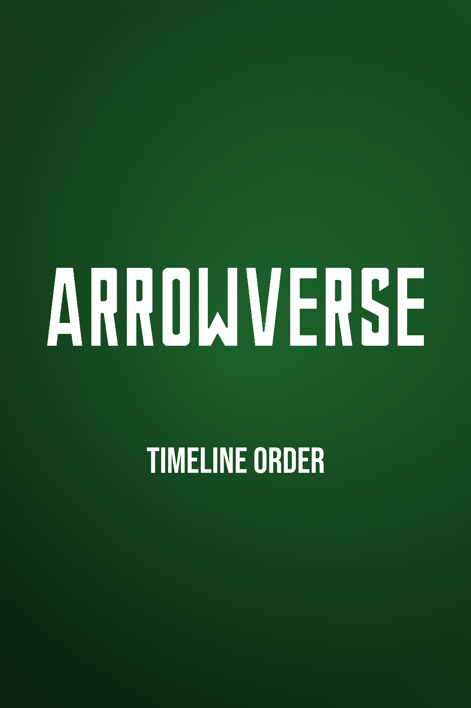

# Portable Team Review Samples

These three focused pairs compare the **current PowerShell reference** with the
**native Python/Pillow candidate**, using the approved fonts. All are 2000 x 3000
JPEGs. They passed the comparison screens, but are not pixel-identical and do
not establish full-batch acceptance. Click images for full resolution.

| Sample | PowerShell Reference | Native Python |
| --- | --- | --- |
| Playlist, Bebas Neue 154 pt |  |  |
| 2020, Jakarta Bold 409 pt |  |  |
| 2021, footless Jakarta 1 |  |  |

| Sample | Mean RGB Error (0-255) | Global Luminance SSIM |
| --- | ---: | ---: |
| Playlist | 0.080995 | 0.999866 |
| 2020 | 0.024789 | 0.999899 |
| 2021 | 0.070318 | 0.999137 |

See [measurements and image/source hashes](measurements.json). Source hashes
describe the render inputs, not documentation-only follow-ups. The 2021 reference
was independently verified against the installed approved configuration. No
restricted font binaries, personal paths, private logs or published-repo checkout
are required to view this bundle.

[The static gallery](index.html) can be opened locally after checking out the
branch; GitHub does not execute repository HTML as a hosted site. The images in
this README work directly on GitHub. No web server is needed.

Return to [the migration review guide](../REVIEW_GUIDE.md) for commands, scope,
remaining provenance questions, and the full comparison gate before cutover.
